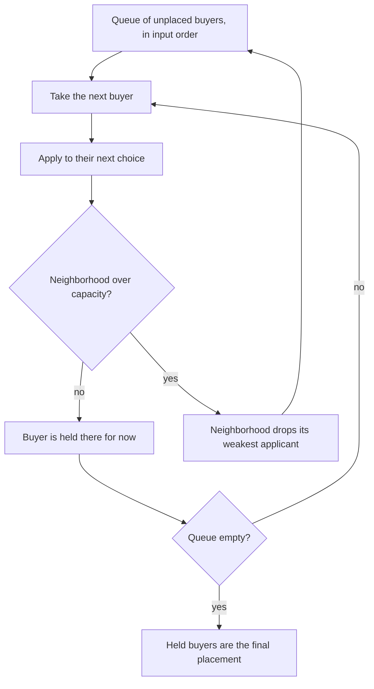

# home-buyer-placement

A solution to a take-home coding assessment: given a set of neighborhoods and a
set of home buyers, place every buyer in exactly one neighborhood so that each
neighborhood gets the same number of buyers, buyers get the highest choice
they can, and each neighborhood keeps the buyers who fit it best.

It is a small, dependency-free Python command-line tool. The interesting part
is the assignment rule, which is spelled out below and pinned down by tests.

## The problem

The input has one line per neighborhood (`N`) and per home buyer (`H`):

```
N N0 E:7 W:7 R:10
N N1 E:2 W:1 R:1
H H0 E:3 W:9 R:2 N2>N0>N1
H H5 E:6 W:7 R:7 N0>N2>N1
```

- A neighborhood has three integer scores, `E`, `W` and `R`.
- A buyer has three integer goals on the same attributes and a preference list,
  best first, separated by `>`.
- A buyer's **fit** for a neighborhood is the dot product of goals and scores.
  H5 in N0 is `6*7 + 7*7 + 7*10 = 161`.
- Every neighborhood takes `buyers / neighborhoods` buyers, so the buyer count
  must be a multiple of the neighborhood count.

The full sample is [examples/input.txt](examples/input.txt), and its expected
result is [examples/expected_output.txt](examples/expected_output.txt). That
expected file is kept in the repository on purpose: it is the reference answer
for the sample, and the test suite compares the CLI output against it.

## How placement works

Placement is buyer-proposing deferred acceptance (the Gale-Shapley algorithm
with capacities):



These rules are covered by the tests in [tests/test_placement.py](tests/test_placement.py):

- **Choice order.** A buyer works down their stated preferences. If all of those
  turn them away, they continue through the neighborhoods they did not list,
  highest fit first. Because total capacity equals the number of buyers,
  everyone gets placed.
- **Who a neighborhood keeps.** A full neighborhood keeps its highest-fit
  applicants. If two buyers have the same fit, the one listed first in the
  input wins. With that tie-break the result does not depend on processing
  order or hash seeds.
- **Stability.** No buyer ends up below a neighborhood they ranked higher if
  that neighborhood holds someone with a lower fit. The tests check this on 200
  random inputs.
- **Output.** Neighborhoods appear in input order. Within each one, buyers are
  sorted by fit, highest first, with ties in input order.

An earlier version of this solution made one pass over the neighborhoods. A
buyer bumped from a later neighborhood could never return to an earlier one,
and leftover buyers could be added to several neighborhoods. It produced the
right answer for the sample, but on random inputs it lost or duplicated buyers
about half the time. The deferred-acceptance version fixes this.

## Setup

You need Python 3.12 or 3.13 ([.python-version](.python-version) pins 3.12).
The tool itself has no runtime dependencies.

```
python3.12 -m venv .venv
. .venv/bin/activate
pip install -e ".[dev]"
```

## Usage

```
$ home-buyer-placement examples/input.txt
N0: H5(161) H11(154) H2(128) H4(122)
N1: H9(23) H8(21) H7(20) H1(18)
N2: H6(128) H3(120) H10(86) H0(83)
```

Each entry is `buyer(fit)`. To write the result to a file, use `-o`:

```
$ home-buyer-placement examples/input.txt -o placements.txt
```

`python -m home_buyer_placement` works the same way.

```
$ home-buyer-placement --help
usage: home-buyer-placement [-h] [-o FILE] input

Place home buyers into neighborhoods. Each buyer's fit for a neighborhood is
the dot product of their E/W/R goals and its E/W/R scores; buyers are assigned
by deferred acceptance over their stated preferences, with every neighborhood
taking the same number of buyers.

positional arguments:
  input                 input file with N (neighborhood) and H (home buyer)
                        lines

options:
  -h, --help            show this help message and exit
  -o FILE, --output FILE
                        write the placements to FILE instead of standard
                        output
```

When the input is invalid, the tool names the line and exits with status 1.
It does not print partial output:

```
$ home-buyer-placement bad.txt
home-buyer-placement: bad.txt: line 3: H0 prefers unknown neighborhood(s): N2
$ home-buyer-placement bad2.txt
home-buyer-placement: bad2.txt: line 3: H line needs 6 fields, got 5
```

The parser rejects the following:

- unknown line types;
- wrong field counts;
- missing, repeated or non-integer attributes;
- empty or repeated preference entries;
- unknown neighborhoods;
- duplicate names.

Blank lines are ignored, and attributes may be given in any order.

## Tests and lint

```
pytest
ruff check . && ruff format --check .
```

## Layout

```
src/home_buyer_placement/
  parsing.py    input format, validation, dataclasses
  placement.py  fit score, capacity, deferred acceptance, output formatting
  cli.py        argparse entry point (console script: home-buyer-placement)
examples/       sample input and its expected placement
tests/          pytest suite
```

## License

MIT. See [LICENSE](LICENSE).
